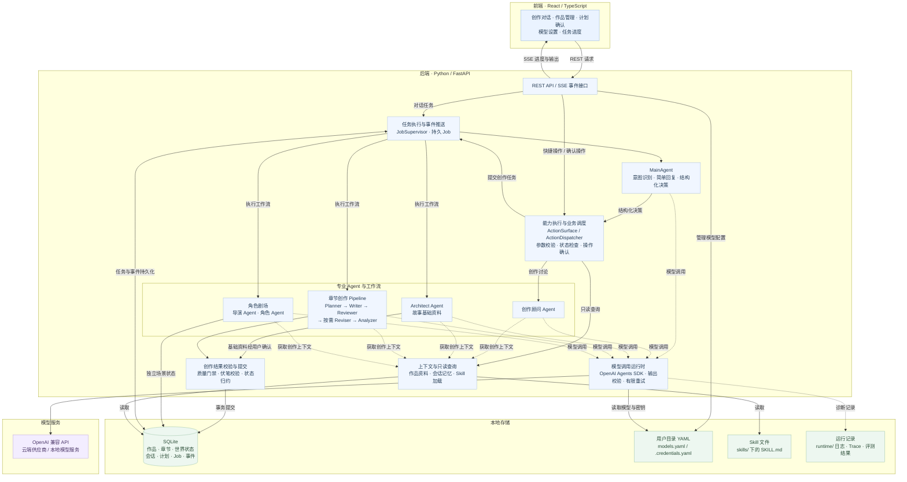

# StoryWeaver - Agent 小说创作工作台

针对长篇小说创作中设定分散、跨章状态难以维护，以及模型生成内容容易出现人物、时间线和伏笔冲突的问题，StoryWeaver 实现了一个面向个人本地使用的 Agent 创作工作台。项目通过对话组织创作讨论、章节规划、正文生成与审稿，由多个专业 Agent 协作完成章节创作，并结合计划确认、质量门禁和事务提交，维护已确认的作品内容与世界状态。

## 核心功能

- **对话式创作入口**：MainAgent 识别普通对话、只读查询和创作动作，输出结构化决策；能力目录从参数 DTO 生成，参数校验失败后支持一次定向修复，信息不足时请求澄清。
- **多 Agent 章节创作**：Architect 生成故事基础资料，Planner、Writer、Reviewer、Reviser 与 Analyzer 完成章节规划、写作、审稿、必要修订和状态提取；支持单章创作、连续创作与章节重写。
- **计划与执行确认**：章节计划按 `pending → approved → confirmed` 推进，批准计划后可单独启动写作。自然语言触发建书、完整章节流程、按计划写作、连续创作与重写时，先展示操作确认卡片。
- **跨章一致性管理**：维护人物状态、世界事实、地点、时间线与开放伏笔；专业 Agent 通过有预算限制的只读工具检索已确认资料，StateReducer 与 HookManager 校验和归约状态变化。
- **质量门禁与候选稿保留**：根据审稿结果、目标字数与一致性约束决定是否提交；未通过门禁的候选稿保留供后续处理，不写入已提交正文与世界状态。
- **持久任务与实时进度**：长任务以 SQLite 中的 Job 运行，通过 SSE 推送阶段、工具调用和任务状态；浏览器断开后任务继续运行，重启后可识别中断任务。
- **创作控制与 Skill**：设置长期作者意图、单章或持续焦点；显式选择创作 Skill 后按调用目标加载，任务与计划冻结 Skill 内容及哈希，保证后续确认和重试使用同一份材料。
- **角色剧场**：从已提交章节的状态快照创建独立场景，通过导演与角色 Agent 推演对话和行动，支持用户扮演角色或旁观场景。
- **本地作品与模型管理**：管理作品、会话和会话记忆，支持 OpenAI 兼容供应商、默认模型、会话模型切换，以及已识别模型的思考等级设置；作品数据和配置保存在本机。

## 技术栈

| 层次 | 技术 | 作用 |
| --- | --- | --- |
| 前端 | React、TypeScript、Vite、React Markdown | 创作对话、作品管理、计划确认及任务进度展示 |
| 后端 | Python、FastAPI、Uvicorn、asyncio | API、业务编排和进程内任务调度 |
| Agent 运行时 | OpenAI Agents SDK | 模型调用、只读工具循环、流式输出及 Trace |
| 数据与事务 | SQLite、SQLAlchemy | 作品、章节、状态、会话、计划、任务与事件持久化 |
| 参数与输出校验 | Pydantic 2、Tenacity | 结构化契约、有限重试和输出修复 |
| 配置与 Skill | YAML、SKILL.md | 模型目录、密钥配置和创作技能加载 |
| 实时通信与部署 | SSE、Docker Compose | 任务事件推送及本地服务启动 |

## 系统架构



架构按前端、后端、模型服务与本地存储分层；图中的实线表示请求、调度或数据读写，虚线表示共享能力调用。后端各模块运行在同一个服务进程中。

- **MainAgent 是对话门面**：负责意图识别、简单回复和选择业务能力；ActionSurface 与 ActionDispatcher 负责查询执行、参数与状态检查，以及确认后的任务调度。
- **专业 Agent 负责创作**：创作顾问承接讨论，Architect 生成基础资料，章节 Pipeline 完成计划、写作、审稿和状态提取，角色剧场负责独立场景推演。
- **代码负责执行与提交**：对话和创作长任务由 JobSupervisor 执行并推送事件；章节正文与世界状态经过业务规则检查后在事务中提交。角色剧场的场景状态与作品正文独立。
- **数据与配置分别保存**：SQLite 保存业务数据与任务记录，用户目录 YAML 保存模型配置和密钥，Skill 使用文件加载，`runtime/` 保存诊断记录。

## 快速开始

### 1. 准备环境

- Python 3.11、Node.js 24 与 npm；或使用 Docker Compose 启动。
- 一个可用的 OpenAI 兼容模型 API，或本机提供同类接口的模型服务。
- 默认使用 SQLite，首次启动自动创建数据库目录与表。

### 2. 启动后端

在项目根目录执行：

```bash
python -m pip install -r requirements.txt
PYTHONPATH=backend/src python -m storyweaver.api.server
```

Windows PowerShell：

```powershell
python -m pip install -r requirements.txt
$env:PYTHONPATH = "backend/src"
python -m storyweaver.api.server
```

### 3. 启动前端

另开终端执行：

```bash
cd frontend
npm install
npm run dev
```

访问工作台 <http://127.0.0.1:5173>；后端默认地址为 <http://127.0.0.1:8000>，健康检查位于 `/api/v1/health`。

### 4. 配置模型并开始创作

点击侧栏底部的设置入口，添加供应商名称、API 地址、模型 ID 和 API Key，并设置默认模型。新会话使用默认模型，可在输入框切换模型；已识别的推理模型支持选择思考等级，提交任务时冻结当前选择。

配置在首次保存供应商后写入当前用户目录：

```text
~/.storyweaver/
├── models.yaml          # 供应商、接口地址、模型列表与默认模型
└── .credentials.yaml    # 各供应商的 API Key
```

后端保存密钥，前端只获取是否已配置密钥的状态。模型配置从这两个 YAML 文件读取，无需 `.env`。

可以先在新会话中讨论故事设定，再生成并确认基础资料；关联作品后，生成下一章候选计划，批准计划并确认写作。

```text
帮我讨论一个末日悬疑故事：主角在避难所发现被涂改的人员名单。
生成下一章候选计划，重点写主角调查名单，先不要写正文。
查看第三章摘要。
当前还有哪些未解伏笔？
```

### Docker Compose 启动

在项目根目录执行：

```bash
docker compose up --build
```

访问地址与本地启动相同。数据库保存到宿主机的 `data/storyweaver.db`，容器模型配置映射到 `data/model-config/`。本地 Python 启动使用 `~/.storyweaver/`，两种启动方式的模型配置目录不同。

## 混合检索与 Embedding API

作品证据工具与会话长期记忆采用“关键词 + 语义”双路召回，以加权 RRF 按排名融合；关键词不是仅在向量无结果时才调用。关键词优先匹配完整子串，并支持中文双字词、英文词匹配。未配置 Embedding、API 超时或向量缓存故障时，自动降级为关键词检索；证据工具返回 `retrieval.mode` 和 `degraded_reason`，不把检索未命中当作事实冲突。

当前范围为事实、伏笔、已提交章节摘要和有效长期记忆；指定章节读取、角色精确查询及基础设定查询沿用现有逻辑。检索候选先按当前作品快照或记忆作用域筛选，再计算向量距离，结果从当前快照返回，保留来源章节和事实有效状态。历史事实可能作为证据返回，但会标记 `superseded`，不能当成当前事实。

向量由 OpenAI 兼容的 `/embeddings` API 生成，本地使用固定版本的 sqlite-vec 计算精确余弦距离，不需要额外向量数据库容器或本地 Embedding 模型。Embedding 和聊天模型统一在现有“模型设置”中管理，无需 `.env` 或 Embedding 环境变量。

1. 打开“模型设置”，在独立的 **Embedding 模型** 区域填写显示名称、API 地址、API Key 和模型 ID，无需添加或选择对话供应商。
2. 可先点击“测试 Embedding”验证填写的接口。测试不会保存尚未提交的地址或密钥。
3. 点击“保存模型配置”，下一次调用自动使用该模型，无需重启服务。需要移除时点击“删除配置”。页面只管理模型，不提供检索方式或参数设置。

对话和 Embedding 配置统一保存在 `~/.storyweaver/models.yaml`，但地址、密钥和模型独立。密钥只保存在 `.credentials.yaml`：对话密钥使用 `api_keys`，Embedding 密钥使用独立的 `embedding_api_key`，前端只获取是否已配置密钥的状态。Docker 使用现有的 `data/model-config/` 挂载目录。修改、删除聊天供应商不会影响 Embedding。启用后，参与检索的资料和查询会发送给独立配置的 Embedding 接口。

以下是 `models.yaml` 的结构示例，也可以直接通过界面保存：

```yaml
version: 1
providers:
  - id: example
    name: 示例供应商
    base_url: https://your-provider.example/v1
    models: [your-chat-model]
default_provider: example
default_model: your-chat-model
embedding:
  name: 我的向量模型
  base_url: https://embedding-provider.example/v1
  model_id: your-embedding-model
```

对应的 `.credentials.yaml` 结构如下，可为两个接口填写完全不同的密钥：

```yaml
version: 1
api_keys:
  example: 你的聊天API密钥
embedding_api_key: 你的Embedding专用密钥
```

检索策略与参数由后端内部管理，不进入前端模型配置接口。默认采用模型输出维度，语义检索总预算为 5 秒，证据工具还会限制在外层超时的 75% 以内。修改地址、模型或密钥从下次调用生效，运行中的调用继续使用开始时选定的配置。未配置独立 Embedding 密钥时不会回退使用聊天密钥，本地接口可以不填密钥。

旧的纯聊天配置可以直接读取。上一版通过 `provider_id` 绑定供应商的 Embedding 配置，会在首次读取时展开为独立配置并复制原密钥，此后与原供应商解除关联。

首次检索按需分批生成缺失向量，后续按内容哈希、供应商地址、模型与维度配置复用缓存。生成索引和查询共用时间预算；超时后本次返回关键词结果，已完成批次保留，下次查询继续补建。更改内容会生成新向量；更换模型会使用独立缓存空间，文档和查询必须使用同一模型。请使用明确的模型版本；供应商若在同一模型名下更换实现，需要清理缓存重建。

向量缓存位于主数据库旁的 `data/storyweaver.retrieval.db`（自定义作品数据库路径时，缓存跟随主库，文件名追加 `.retrieval`）。缓存独立于作品数据库、可重建，不属于作品恢复的必需备份。停止服务后可删除缓存及对应的 `-wal`、`-shm` 文件重建；不会删除原始作品或记忆。当前为候选集内精确扫描，后续应按实际延迟决定是否升级索引方案。

## 数据存储与备份

默认数据库位于项目根目录的 `data/storyweaver.db`。可通过 `STORYWEAVER_DATABASE_PATH` 覆盖路径，相对路径按项目根目录解析，支持 `~`。

SQLite 启用 WAL、外键约束和锁等待；同一作品同时只允许一个活动写入任务。当前服务运行一个 FastAPI 进程，数据库文件锁阻止重复启动同一数据库，模型调用在事务外执行。

使用 SQLite 备份接口保存已提交数据：

```bash
PYTHONPATH=backend/src python -m storyweaver.persistence.backup
```

默认备份写入 `data/backups/`。应用运行期间不要仅复制 `.db` 文件，最新数据可能仍在 WAL 中；恢复前先关闭服务并保留原数据库文件。`data/` 与 `runtime/` 的运行产物均被 Git 忽略，移动或删除项目时请保留作品与备份。

## 测试与评测

安装后端依赖后，使用 pytest 收集后端单元测试与集成测试：

```bash
python -m pip install pytest
PYTHONPATH=backend/src:backend/tests python -m pytest backend/tests -q
```

MainAgent 路由评测包含 50 条标注用例，覆盖普通回复、只读查询、创作讨论、创作动作和澄清边界。在项目根目录运行：

```bash
# 只校验用例，不调用模型
PYTHONPATH=backend/src python backend/route_evals/evaluate.py --check

# 运行指定用例
PYTHONPATH=backend/src python backend/route_evals/evaluate.py --id reply_01 --id query_04 --id action_05

# 调用已配置模型，运行全部 50 条
PYTHONPATH=backend/src python backend/route_evals/evaluate.py
```

报告保存到 `runtime/route_evals/`，记录路由准确率、参数通过情况、不符合预期的工作流选择、耗时及逐条输出。评测只调用 MainAgent 决策，不实际启动创作任务；使用说明见 [路由评测文档](backend/route_evals/README.md)。

前端构建校验：

```bash
cd frontend
npm run build
```

## 项目结构

```text
StoryWeaver/
├── backend/
│   ├── src/storyweaver/
│   │   ├── api/              # FastAPI、MainAgent、动作调度与 JobSupervisor
│   │   ├── application/      # 会话、工作台和创作任务编排
│   │   ├── novel_creation/   # 专业 Agent、章节 Pipeline、质量门禁与状态归约
│   │   ├── story_simulation/ # 角色剧场、导演与角色 Agent
│   │   ├── persistence/      # SQLite 表、Repository 与事务
│   │   ├── memory/           # 会话记忆提取与检索
│   │   ├── skills/           # Skill 发现、加载与快照
│   │   ├── llm/              # 模型调用、事件与有限重试
│   │   ├── model_config/     # YAML 模型目录与密钥管理
│   │   ├── evaluation/       # 小说创作质量评测
│   │   └── observability/    # 日志、Trace 与失败诊断
│   ├── tests/                # 后端测试
│   └── route_evals/          # MainAgent 路由用例与评测脚本
├── frontend/                 # React + TypeScript 工作台
├── skills/builtin/           # 内置创作 Skill
├── data/                     # 本地数据库与备份
├── runtime/                  # 日志、Trace、诊断与评测结果
├── Dockerfile
├── docker-compose.yml
├── requirements.txt
└── README.md
```

当前版本定位为单用户本地工作台，采用单实例、进程内任务调度。服务重启后会将运行中任务标记为中断；已提交章节保留，模型调用不承诺仅执行一次。多用户认证、多租户与分布式 Worker 尚未实现。
